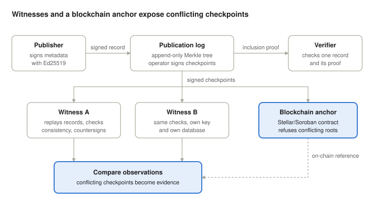

# OpenMeta Witness

Proof of concept for publishing signed package metadata to an append-only
log and having independent witnesses check it.

Publishers sign metadata records with Ed25519. Records go into a Merkle tree
log, the log operator signs checkpoints, and witnesses verify each new
checkpoint against the last one they saw. If the operator shows different
witnesses different histories, comparing their observations exposes it.

Not production software.

## Build

    cargo build --release

## Demo

    cargo run -p openmeta-cli -- demo

Runs a fixed scenario in `./openmeta-demo`: publish, checkpoint, two
witnesses verify, a tampered record is rejected, and a conflicting
checkpoint is caught when the witnesses compare.

## Layout

    crates/openmeta-core     metadata types, canonical encoding, signing
    crates/openmeta-log      Merkle log, checkpoints, witnesses
    crates/openmeta-store    SQLite storage and key files
    crates/openmeta-anchor   checkpoint commitments, local ledger
    crates/openmeta-cli      the openmeta command
    contracts/               Soroban contract for anchoring

## Tests

    cargo test --workspace

## License

Apache-2.0
